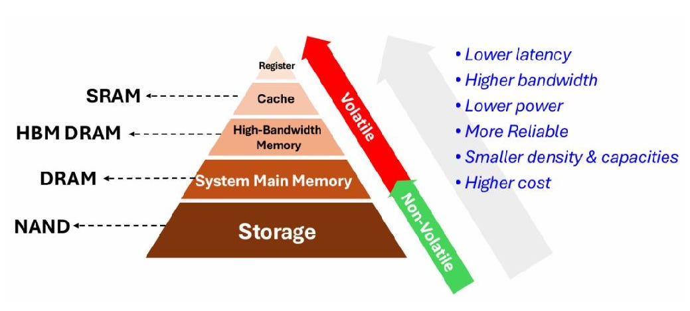
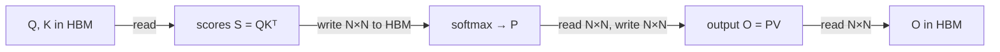

# FlashAttention: Fast and Memory-Efficient Exact Attention with IO-Awareness


Paper: [NeurIPS 2022](https://papers.nips.cc/paper_files/paper/2022/file/67d57c32e20fd0a7a302cb81d36e40d5-Paper-Conference.pdf) · [arXiv:2205.14135](https://arxiv.org/abs/2205.14135) · Code: [Dao-AILab/flash-attention](https://github.com/Dao-AILab/flash-attention)

---

## TL;DR

FlashAttention computes **exactly the same attention** as a normal Transformer. It does not change the model or the math, only the order in which the GPU does the work. Standard attention builds a huge N×N table of scores in the GPU's slow memory and reads it back several times. FlashAttention never builds that table: it works through the input in small blocks that fit in the GPU's fast memory, and combines the block results so the final answer is identical. The result is about 3× faster training and memory that grows linearly with sequence length instead of quadratically, which in turn makes much longer contexts affordable.


## The Challenge: Why Long Context Is Hard for Transformers

In attention, every token compares itself with every other token. For a sequence of N tokens, that produces an **N×N table of scores**.

| Sequence length N | Entries in the table (per head) |
|---|---|
| 1K | 1 million |
| 16K | 256 million |
| 64K | about 4 billion |

Doubling the context makes the table four times bigger. The table is too large for the GPU's fast memory, so it sits in the slow memory and gets written and re-read several times (once for the scores, once for the softmax, once for the final multiply, and again during the backward pass).

Many earlier papers tried to fix this with **approximate attention** (sparse, low-rank, and so on): skip part of the table and accept a slightly worse model. They did reduce the amount of arithmetic, but often did not run any faster in practice. Section 2 explains why.


## FLOPs vs. Wall-Clock Time

- **FLOPs** (floating-point operations) count the arithmetic: how many additions and multiplications the algorithm performs.
- **Wall-clock time** is what a stopwatch shows: how long you actually wait.

They sound like the same thing, but FLOPs ignore the time spent **moving data** between memory and the processor. On a modern GPU the arithmetic is very fast and the data movement is the slow part, so an algorithm with fewer FLOPs can still be slower.

FlashAttention does *more* arithmetic and is still 3× faster, because it moves 8× less data. That is what "IO-aware" means: design the algorithm around the cost of reading and writing memory (IO = input/output), not only around the amount of arithmetic.


## HBM and SRAM: The Two Kinds of GPU Memory

Both of these are **inside the GPU**. Neither is CPU memory.



- **HBM (high-bandwidth memory)** is the "GPU memory" you see in `nvidia-smi`, the 40 GB or 80 GB number. Large, but comparatively slow to reach.
- **SRAM** is a tiny amount of memory sitting right next to the GPU's compute cores. It is more than 10× faster than HBM but about 2,000× smaller.


## What Standard Attention Does

$$\text{Attention}(Q, K, V) = \text{softmax}\!\left(\frac{QK^\top}{\sqrt{d}}\right)V$$



Each arrow that carries an N×N table is a slow trip. The backward pass needs the table again, so it is kept in HBM for the whole training step. That is where both the time and the memory go.


## The Two Ideas in FlashAttention

### Tiling: compute the softmax without seeing the whole row

**The obstacle.** Softmax turns a row of scores into weights that add up to 1, by dividing each one by the sum over the *whole row*. So it seems you need the full row before you can produce anything.

**The trick.** You can go through the row a block at a time if you keep one extra number: the **running sum so far**. When a new block arrives, the sum grows, so you shrink the result you already have by `old sum / new sum` and then add the new block's contribution.


**The full procedure:**

1. Split Q, K and V into blocks small enough to fit in SRAM.
2. Load a block of K and V from HBM into SRAM.
3. For each block of Q, load it into SRAM and compute attention for just that tile of the table.
4. Rescale the output so far by the right normalization factor, add the new contribution, and write the updated output back to HBM.
5. Repeat until every K/V block has been visited.


### Recomputation: do not store the table for the backward pass

Training needs a backward pass, and the standard backward pass needs the N×N attention table from the forward pass. Storing it is what makes memory quadratic.

FlashAttention stores only the **softmax normalization factors** from the forward pass (one small number per row, so N numbers instead of N²). In the backward pass it reloads the Q, K, V blocks into SRAM and **recomputes** each tile of the table on the spot.

This is extra arithmetic (it explains the higher FLOP count in Section 2), but recomputing a tile on the desk is faster than fetching it from the storage room.


## Attention vs. FlashAttention vs. Block-Sparse FlashAttention

Strictly speaking these are three ways of *computing* attention rather than three model architectures. The first two give the same model.

```
  Standard attention        FlashAttention            Block-sparse FlashAttention

  ■ ■ ■ ■ ■ ■               ■ ■ | ■ ■ | ■ ■           ■ ■ | · · | ■ ■
  ■ ■ ■ ■ ■ ■               ■ ■ | ■ ■ | ■ ■           ■ ■ | · · | ■ ■
  ■ ■ ■ ■ ■ ■               ----+-----+----           ----+-----+----
  ■ ■ ■ ■ ■ ■               ■ ■ | ■ ■ | ■ ■           · · | ■ ■ | · ·
  ■ ■ ■ ■ ■ ■               ■ ■ | ■ ■ | ■ ■           · · | ■ ■ | · ·
  ■ ■ ■ ■ ■ ■               ----+-----+----           ----+-----+----
                            ■ ■ | ■ ■ | ■ ■           ■ ■ | · · | ■ ■
  whole table built         ■ ■ | ■ ■ | ■ ■           ■ ■ | · · | ■ ■
  and stored in HBM
                            every tile computed,      only chosen tiles computed,
                            one at a time in SRAM,    the rest (·) skipped
                            none stored
```

| | Standard | FlashAttention | Block-sparse FlashAttention |
|---|---|---|---|
| Which token pairs are compared | all | all | only those in the chosen blocks |
| Output | exact | exact | **approximate** |
| Stores the N×N table | yes | no | no |
| Memory | quadratic | linear | linear |
| Speed | baseline | up to ~3× faster | faster again, in proportion to how many blocks are skipped |
| Slow-memory trips | Θ(Nd + N²) | Θ(N²d²/M) | Θ(Nd + N²d²s/M) |

*s* is the fraction of blocks that are kept. If you keep 20% of the blocks, the main cost drops to roughly 20%.

Block-sparse FlashAttention is the same block-by-block loop with one extra rule: you supply a pattern saying which blocks matter, and the loop skips the rest. It gives up exactness in exchange for reaching very long sequences (64K in the paper).


## How Is This Different from Mamba?

Both papers start from the same observation about GPU memory (HBM is slow, SRAM is fast), but they solve different problems. See the [Mamba summary](../Mamba/ReadMe.md) for the other side.

| | FlashAttention | Mamba |
|---|---|---|
| What changes | **How** attention is computed | **What** is computed: attention is replaced by a different model |
| Model architecture | Unchanged Transformer | New architecture (selective state-space model) |
| Output | Identical to standard attention | A different model with different behavior |
| Arithmetic cost | Still O(N²) | O(N) |
| Memory | O(N) | O(N) |
| Can look back at any earlier token exactly | Yes, it is still full attention | No, history is compressed into a fixed-size state |
| Drop-in for existing models | Yes, no retraining needed | No, a new model must be trained |

In short: **FlashAttention is an engineering fix that leaves the model alone; Mamba is a modeling change.** FlashAttention makes each of the N² comparisons cheap to execute. Mamba avoids doing N² comparisons at all, and pays for it by forgetting some detail.

They are also directly connected. Mamba's fast scan borrows two tricks from this paper: do the whole computation inside SRAM instead of writing intermediate results to HBM, and recompute intermediate values in the backward pass instead of storing them (Section 5.2 of the Mamba summary). Mamba even measures its memory use against a Transformer running FlashAttention.

## Limitations and Future Directions

**1. Compiling to CUDA.**
*What the paper says:* every new attention variant needs a new hand-written CUDA kernel.
*What it means:* FlashAttention cannot be written in ordinary PyTorch, because PyTorch gives no control over what sits in SRAM. It has to be written in low-level GPU code, which is slow to write, hard to modify, and may not carry over to other GPU types. If you want a small variation on attention, someone has to redo that low-level work. The authors would like a tool that takes attention written in a high-level language and generates the memory-efficient GPU code automatically (as Halide does for image processing).

**2. IO-aware deep learning beyond attention.**
*What the paper says:* every layer touches HBM, not only attention.
*What it means:* attention was the worst offender, but the same "organize the work around memory trips" idea could speed up other layers too. Mamba's scan (Section 8) is an example of this happening.

**3. Multi-GPU.**
*What the paper says:* the algorithm is optimal for a single GPU.
*What it means:* the analysis only considers the two memory levels inside one GPU. When training is spread across several GPUs, moving data *between* GPUs is another, even slower kind of trip, and the paper does not account for it.

**Two more things worth keeping in mind** (not in the paper's list, but they follow from it):

- The arithmetic is still quadratic. FlashAttention makes long contexts affordable, not free: at very long lengths the N² work catches up again.
- The exact version does not change what the model learns. Any quality gain comes only from being able to train with longer sequences.
