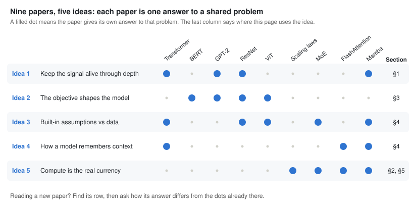
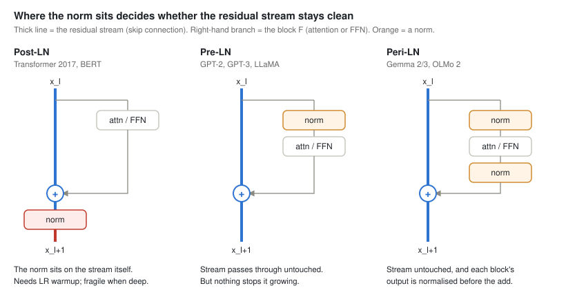
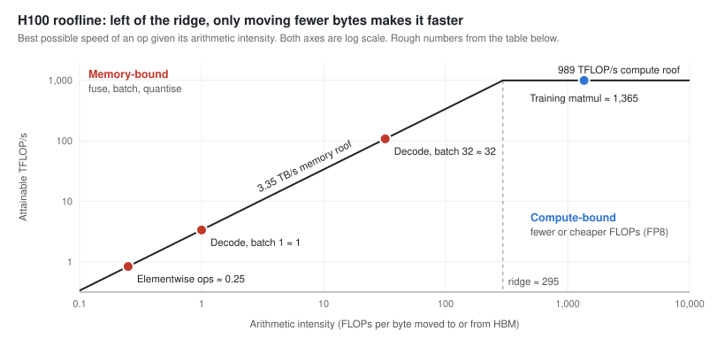
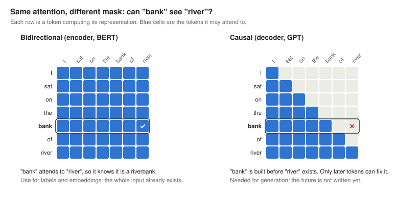
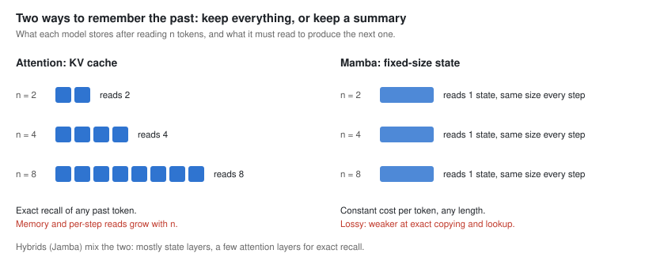
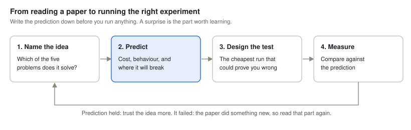

# Foundational Architecture and Representation Learning: From understanding to judgment

Oct 18, 2026 

As I wrap up this section, I wanted a final summary page that answers one question: ok, we learned all the math behind these papers, so what? How does knowing the math help me as a machine learning engineer? What do I carry with me after this exercise, and what vision or perspective should it give me?

If I just move on without reflecting, I'm no more than a parrot. That's where understanding vs judgment comes in. Implementations are all over the internet, you can find thousands of them, but this reflection feels like the missing piece. At least that's what I think.

Understanding means you can explain and rebuild a mechanism. Judgment means you can pick a mechanism under constraints and predict the consequence before you see it.

**The goal of this page:** use research the way an engineer uses physics. Before spending a single GPU hour, I want to be able to predict how a model will behave, what it will cost and where it will break, and then design the experiment that checks that prediction.

Anyone who has read these papers, or implemented them, must have noticed a lot of repetition. That got me thinking: maybe the point of this exercise isn't just going through the math. Maybe it's spotting the recurring ideas behind it. The more models I went through, the more they seemed to rely on a handful of ideas and grow from there.

This is good news, because it means I can look at any new model, idea or paper, quickly get a grasp of what it is, and predict how it will behave, how much it will cost and where it will break. 


## The map: five ideas under nine papers

This is the repetition I kept seeing, boiled down: nine papers, five ideas. Each idea is a problem every model has to solve, and each paper is one answer to it. A new paper is usually a new answer to one of these five problems, so I can read it as a diff against something I already know.



The rest of the page is these five ideas used on real engineering decisions. Every section says which idea it applies and ends with the question to ask about any new model.

| Idea | The problem | The question to ask | Used in |
| --- | --- | --- | --- |
| 1. Keep the signal alive through depth | Small per-layer changes in scale compound over dozens of layers | What keeps activations and gradients at a sane scale as the model gets deeper? | [§1 LayerNorm](#1-idea-1-in-practice-where-to-put-layernorm) |
| 2. The objective shapes the model | The architecture decides what a model *can* represent; the loss decides what it learns to do | What exactly does the loss reward, and what behaviour will follow? | [§3 Encoder or decoder](#3-idea-2-in-practice-bidirectional-vs-causal), [§4](#4-ideas-2-to-5-in-production-the-transformers-limits) |
| 3. Built-in assumptions vs data | Assumptions save data when right, and become a ceiling when data is plentiful | What does this model assume, and do I have enough data to not need it? | [§4](#idea-3-built-in-assumptions-vs-data) |
| 4. How a model remembers context | How much of the past to keep, and what looking it up costs | How much state does it keep per token of history, and what does reading it cost? | [§4](#idea-4-how-a-model-remembers-context), [§5](#5-idea-5-and-4-in-numbers-back-of-the-envelope-estimates) |
| 5. Compute is the real currency | Capability is bought with FLOPs and bytes | Is this limited by compute or by memory bandwidth? | [§2 HBM vs SRAM](#2-idea-5-in-practice-hbm-vs-sram), [§5](#5-idea-5-and-4-in-numbers-back-of-the-envelope-estimates) |

Inside those ideas, the same five motifs keep coming back. When a paper looks new, it's often one of these in a new place:

- **Skip connection:** ResNet, the LSTM cell state, Pre-LN, the residual stream.
- **Gating:** LSTM gates, SwiGLU, Mamba's gate branch, the MoE router.
- **Store vs recompute:** gradient checkpointing, FlashAttention's backward pass, Mamba's scan.
- **Conditional computation:** MoE, sparse attention, Mamba's input-dependent selection.
- **Normalising scale:** BatchNorm, LayerNorm, RMSNorm, QK-norm.

## 1. Idea 1 in practice: where to put LayerNorm


> **Idea 1: keep the signal alive through depth.** A deep net is a long chain of layers. If each layer scales its output by just 1.1×, the effect compounds: after 48 layers the signal is 1.1⁴⁸ ≈ 97× larger. The opposite is just as bad: if each layer scales by 0.9×, only 0.9⁴⁸ ≈ 0.006 (under 1%) of the signal survives. Gradients go back through the same chain, so they explode or vanish the same way, and training diverges or stalls. Where you put the norm is the most common engineering decision this idea drives.

LayerNorm rescales each token's hidden vector to mean 0 and variance 1, then applies a learned scale and bias, so activations keep a predictable scale through dozens of layers. RMSNorm (LLaMA and most LLMs now) skips the mean subtraction, so it's slightly cheaper.

The three designs below differ only in where the norm sits relative to the skip.



### Post-LN: normalise after the add (Transformer 2017, BERT)

```python
x = norm(x + attn(x))
x = norm(x + ffn(x))
```

The norm sits on the skip path, so x is rescaled after every block and never reaches the output untouched. Gradients pass back through all those norms too, so there's no clean identity path. [Xiong et al. (2020)](https://arxiv.org/abs/2002.04745) showed the result: at init, gradients near the output are large, so at full learning rate the top layers get huge updates and training diverges. Hence LR warmup (ramp up from a tiny LR over a few thousand steps). More layers means more norms on the path, so it gets worse with depth.

**Key takeaway:** Post-LN is harder to train, but it works well for shallow models (6 to 24 layers, like the original Transformer and BERT) if you use LR warmup. When it does train, it can slightly outperform Pre-LN, because renormalising after every block stops the residual stream from growing, so later layers' contributions stay significant instead of being drowned out. Use it when reproducing or fine-tuning a BERT-era model, keeping the architecture its checkpoint was trained with. Avoid it for deep models or high learning rates unless you add a fix like DeepNorm.

### Pre-LN: normalise the input of each block (GPT-2 onwards)

```python
x = x + attn(norm(x))
x = x + ffn(norm(x))
x = norm(x)  # final norm before the output head
```

The norm moves inside the branch: each block reads a normalised copy of x, but its output is added to the raw stream. The skips carry x untouched, so gradients reach every layer at full strength and deep models train with little or no warmup. GPT-3, LLaMA and most LLMs since use this, usually with RMSNorm. The final norm is there because nothing else normalises the stream before the output head.

The cost: nothing ever rescales the stream, so it keeps growing with depth.

- **Deep layers do less.** Each block's output stays about the same size while the stream grows (its variance roughly linearly with depth), so by layer 40 a block barely changes it. [The Curse of Depth (2025)](https://arxiv.org/abs/2502.05795) blames this for many underused deep layers in LLMs.
- **Huge activations stick around.** A very large value from one block is never scaled back down, so every later layer sees it. In big runs this shows up as loss spikes.

**Key takeaway:** Use Pre-LN with RMSNorm as your default, especially for deep models. It trains stably from step 1, needs little or no warmup and tolerates higher learning rates. Its weakness is that nothing rescales the residual stream, so in large or long runs the stream grows with depth. Watch for activation norms climbing layer by layer and for sudden loss spikes. If you see them, switch to Peri-LN or add QK-norm before you change the learning-rate schedule.

### Peri-LN: normalise both sides (Gemma 2/3, OLMo 2)

```python
x = x + norm_out(attn(norm_in(x)))
x = x + norm_out(ffn(norm_in(x)))
```

Pre-LN plus a norm on each block's output. The skips stay clean, and the output norm caps what each block can add, which removes the cause of Pre-LN's loss spikes. Gemma 2 and 3 use both norms. OLMo 2 uses only the output norm (x + norm(F(x))) plus QK-norm, which normalises queries and keys so attention scores can't grow until the softmax saturates.

**Key takeaway:** Use Peri-LN for large, deep or long training runs, or switch to it when a Pre-LN run shows loss spikes or activation norms climbing with depth. It keeps Pre-LN’s clean skip path but normalises each block’s output before adding it, so no single block can push a huge value into the stream. The extra norm per sublayer is cheap, which is why Gemma 2/3 use it by default and OLMo 2 adopts its output-norm half. For small models, Pre-LN is enough.

The same three as equations, with F = attention or FFN:

$$\text{Post-LN:}\quad x_{l+1} = \mathrm{LN}\big(x_l + F(x_l)\big)$$

$$\text{Pre-LN:}\quad x_{l+1} = x_l + F\big(\mathrm{LN}(x_l)\big)$$

$$\text{Peri-LN:}\quad x_{l+1} = x_l + \mathrm{LN}\Big(F\big(\mathrm{LN}(x_l)\big)\Big)$$


|  | Post-LN | Pre-LN | Peri-LN |
| --- | --- | --- | --- |
| Used by | Transformer 2017, BERT | GPT-2, GPT-3, LLaMA | Gemma 2/3, OLMo 2 (output norm only) |
| Good | Stream stays at a fixed scale | Stable at depth, little or no warmup needed | Clean skip connections, and no block output can get too big |
| Watch out for | Needs warmup; unstable when deep | Stream norm grows; deep layers underused; loss spikes | One extra norm per sublayer |

### The same idea in the other papers

Norm placement is one answer to Idea 1. The other papers each found their own:

- **ResNet:** skip connections (x + F(x)), so the gradient always has a direct route back to the early layers.
- **Transformer:** divides attention scores by √d\_k. A dot product of two d\_k-dimensional vectors has variance around d\_k, so without the scaling softmax saturates to nearly one-hot and its gradients become tiny.
- **GPT-2:** Pre-LN, plus scaling each residual block's output weights at init by 1/√N, because each of the N blocks adds variance to the residual stream. With that scaling, the stream's total variance at init stays about the same however deep the model is.
- **Mamba:** the state's decay factor is exp(ΔA) with A negative, so it always stays between 0 and 1 and the recurrence can't blow up.

**The question to ask about any new architecture.** These two questions predict how a model will train before you run anything:

1. **Does x pass through untouched somewhere?** If a norm sits on the skip connection (like Post-LN), expect it to need warmup and to get fragile as it gets deeper.
2. **What stops the residual stream from growing?** If nothing does (like Pre-LN), expect deep layers to do less and loss spikes at scale.

**How to catch it in your own training.** When a run diverges or stalls, check scale first. Log the activation norm and gradient norm per layer. Each failure shows up there before the loss curve looks bad:

| Problem | What you'll see in the per-layer logs |
| --- | --- |
| Post-LN blowing up | Very large gradient norms in the top layers in the first few hundred steps |
| Pre-LN stream growing | Activation norm climbing steadily with layer number |
| Loss spike coming | One layer's activation norm suddenly jumping |

```python
# gradient norm per parameter, after loss.backward()
for name, p in model.named_parameters():
    if p.grad is not None:
        log(f"grad_norm/{name}", p.grad.norm().item())

# activation norm per block, with a forward hook
for i, block in enumerate(model.blocks):
    block.register_forward_hook(
        lambda m, inp, out, i=i: log(f"act_norm/block_{i}", out.norm(dim=-1).mean().item())
    )
```

## 2. Idea 5 in practice: HBM vs SRAM

> **Idea 5: compute is the real currency.** Capability is bought with FLOPs and bytes. Since about 2020, most architecture papers are answering one question: how do I get more capability per FLOP, or per byte? The trap is thinking only FLOPs count. On a GPU, the bytes you move are often the real bill.

A GPU has two memories that matter here. HBM is the big off-chip memory (80 GB on an H100) where the weights, activations and KV cache live. SRAM is the small on-chip memory right next to the compute units (shared memory and registers: a few hundred KB per SM, tens of MB across the chip). Anything a kernel computes on has to be read from HBM into SRAM first, and the result written back.

The numbers on an H100: about 989 TFLOP/s of dense BF16 compute, but only about 3.35 TB/s of HBM bandwidth. Divide one by the other and you get roughly 295. In the time it takes to read one byte from HBM, the GPU could have done about 295 FLOPs.

That gives a simple test for any operation (one computation the GPU runs on tensors, such as a matrix multiply, a softmax or a LayerNorm), called arithmetic intensity:

$$\text{arithmetic intensity} = \frac{\text{FLOPs}}{\text{bytes read and written to HBM}}$$

$$\text{H100 ridge point} \approx \frac{989\ \text{TFLOP/s}}{3.35\ \text{TB/s}} \approx 295\ \text{FLOPs/byte}$$

If an operation does more than about 295 FLOPs per byte, it's compute-bound: the tensor cores are the bottleneck, and only fewer or cheaper FLOPs will speed it up. If it does fewer, it's memory-bound: the GPU sits idle waiting on HBM, and only moving fewer bytes helps. A GPU with more FLOPs but the same bandwidth won't make it faster.

The picture below is called a roofline. Find your operation's intensity on the x-axis; the line above it is the fastest it can ever run.



**When to use it.** Arithmetic intensity is a diagnostic: reach for it when something is slower than expected, or before you spend time optimising. It tells you which kind of fix will actually work.

- **Low GPU utilisation (low MFU):** your operations are probably below the line, so the GPU is waiting on memory. Fuse operations, batch more, or move fewer bytes. More FLOPs won't help.
- **Speeding up inference:** decode is memory-bound, so quantising weights and batching requests help, while a GPU with more FLOPs but the same bandwidth barely does. Prefill is the opposite: it's compute-bound, so there FLOPs are what count.
- **Picking a GPU:** for LLM serving, look at bandwidth (TB/s) first. For large-batch training, look at FLOPs.
- **Deciding if an optimisation is worth it:** if the operation is memory-bound, cutting FLOPs is wasted effort. FlashAttention does the same FLOPs as normal attention and wins purely on bytes.
- **Reading papers:** GQA, MLA, KV-cache quantisation and kernel fusion are all about bytes, not FLOPs. Thinking in intensity tells you when they'll help (decode) and when they won't matter much (training).

You rarely need an exact number. A rough guess like “each weight is used once per token, so about 1 FLOP per byte, so memory-bound” is usually enough. To measure it, use a profiler such as Nsight Compute or the PyTorch profiler.

| Operation | FLOPs per byte (rough) | Bound by | What helps |
| --- | --- | --- | --- |
| Training matmul: 4096 × 4096 weights times 4096 tokens, BF16 | \~1,365 | Compute | FP8, keep the batch large |
| Decoding at batch size 1 | \~1 (each 2-byte weight does one multiply-add) | Memory | Batching, weight quantisation, smaller KV cache (GQA/MLA), speculative decoding |
| Elementwise operations: softmax, LayerNorm, GELU, residual add | < 5 | Memory | Kernel fusion (torch.compile or fused kernels) so each tensor is read once |
| Naive attention at N = 8K | Writes the N × N score matrix to HBM and reads it back | Memory | FlashAttention (F.scaled\_dot\_product\_attention): tile Q, K, V into SRAM and never write N × N |

**Worked example: decoding Llama-2-7B at batch 1.**

To generate one token, the GPU has two jobs: read the weights from HBM, and do the maths with them. The question is which one takes longer.

- Reading: the model has 6.74B weights at 2 bytes each, about 13.5 GB. Every new token is one forward pass that uses every weight once, so all 13.5 GB must be read for every token. At 3.35 TB/s that takes about 4 ms, which caps decode at about 250 tokens/s.

- Maths: each weight does one multiply-add (2 FLOPs), so a token costs about 13.5 GFLOPs. At 989 TFLOP/s that takes about 14 µs.

Reading takes roughly 300× longer than the maths. The compute units finish almost instantly and then wait for the next weights to arrive, so decode is memory-bound: its speed is set by bandwidth, and a chip with more FLOPs but the same bandwidth won’t be any faster. In practice you’ll measure less than 250 tokens/s, because real kernels don’t reach peak bandwidth and the KV cache has to be read as well.

Once you see that bytes are the bottleneck, the standard serving tricks make sense. Each one either moves fewer bytes or gets more tokens out of the same bytes:

- Quantise the weights. int4 weights are 4× smaller than BF16 (about 3.4 GB), so each token needs a quarter of the reading, and decode gets up to about 4× faster.
- Batch requests. With 32 requests, the GPU reads each weight once and uses it for all 32 next tokens. Reading still takes about 4 ms, but it now produces 32 tokens, so throughput rises close to 32× until the extra work catches up. This is what continuous batching in servers like vLLM exploits. On the roofline, batching moves the decode dot to the right: the same bytes now do more FLOPs.
- Shrink the KV cache. Each request also reads its own KV cache on every step, and that cache grows with context length. At long context it can rival the weights, and batching doesn’t share it across requests. GQA, MLA and KV-cache quantisation all shrink this second read (§5 shows how to size it).

The same comparison explains why prefill and decode behave so differently. Prefill processes the whole prompt in parallel: each weight is read once but used for every prompt token, so the maths dominates and it’s compute-bound. That sets your time to first token. Decode produces one token at a time: each weight is read for a single token’s worth of maths, so it’s memory-bound. That sets your tokens per second.

### How FlashAttention and Mamba are built around this

Both use the same trick: the big intermediate tensor never leaves SRAM. Load the small inputs, do all the work on-chip in one fused kernel, and write only the small output back to HBM.

**FlashAttention.** Standard attention runs as separate kernels, and every step round-trips through HBM:

```python
S = Q @ K.T        # N×N scores, written to HBM
P = softmax(S)     # read S back, write N×N P to HBM
O = P @ V          # read P back again
```

At N = 8,192 that's 67M scores per head (about 134 MB in FP16), written and read several times, for every head in every layer. Moving that data is the cost, not the matmuls.

FlashAttention fuses all of it into one kernel and works in tiles:

1. Split Q, K and V into blocks small enough to fit in SRAM. The block size comes from the SRAM size M and the head dim d (B\_c = ⌈M / 4d⌉).
2. Load a block of K and V, and a block of Q, into SRAM, and compute that block of scores there.
3. Update the softmax incrementally (online softmax): keep a running max m and running sum ℓ for each row, and rescale the partial output whenever the max changes.
4. Accumulate the output O on-chip and write only O (N × d) to HBM. The N × N matrix never exists in HBM.
5. In the backward pass, don't store P. Recompute the score blocks from Q, K, V and the saved m and ℓ. That's more FLOPs but far fewer bytes, so it's faster overall.


*Standard attention vs FlashAttention · HBM traffic*

Left: three separate kernels, and the N × N matrices S and P make round trips to HBM. Right: one fused kernel; S only ever exists as small tiles in SRAM, and only O is written back.

Online softmax on a small example: one row of scores \[1, 2, 3, 4\], processed as two blocks.

- Block 1 is \[1, 2\]: running max m = 2, running sum $\ell = e^{1-2} + e^{2-2} = e^{-1} + e^{0} = 1.368$.
- Block 2 is \[3, 4\]: the new max is 4, so rescale the old sum by $e^{2-4}$ and add the new terms: $\ell = e^{-2} \times 1.368 + (e^{-1} + e^{0}) = 1.553$.
- Check against the full row: $e^{-3} + e^{-2} + e^{-1} + e^{0} = 1.553$. Same answer, without ever holding the whole row.


*Online softmax · two blocks, one exact result*

Only two numbers per row (m and ℓ) travel between blocks, and the final sum is exactly the same as computing the whole row at once.

The output is exactly the same as standard attention (it's not an approximation). Memory grows linearly with N instead of quadratically, and the paper reports up to 7.6× faster attention on GPT-2. HBM accesses drop from Θ(Nd + N²) to Θ(N²d² / M), with M the SRAM size. In other words, the N² term gets multiplied by d²/M. For typical head dims (64–128), d² is several times smaller than M, so the N² traffic shrinks by that factor. Note what FlashAttention does *not* change: what attention remembers (Idea 4). It only changes how efficiently the same thing is computed.

**Mamba.** Mamba's selective SSM keeps a hidden state of size N for every channel, so the expanded state has shape (batch, length, D, N): N times bigger than the input. Because Δ, B and C depend on the input, Mamba can't use S4's convolution shortcut. It has to run the recurrence as a scan. A naive implementation writes that whole expanded state to HBM: at length 2,048, 4,096 channels and N = 16, that's about 134M numbers (around 268 MB) per layer.

Mamba's fused kernel avoids that:

1. Load Δ, A, B and C (about batch × length × (D + N) numbers) from HBM into SRAM.
2. Discretise (Ā = exp(ΔA), plus B̄) and run the recurrence in SRAM, using a parallel scan so it doesn't go one step at a time.
3. Write only the output y (batch × length × D) back to HBM.
4. In the backward pass, recompute the states instead of storing them.


*Naive scan vs Mamba fused scan · HBM traffic*

Same pattern as FlashAttention: the naive version spills the N-times-bigger state to HBM and reads it back; the fused kernel keeps it on-chip and writes only y.

That cuts memory traffic by about a factor of N (16× at N = 16).

Both are the “store vs recompute” motif from the map at the top, plus kernel fusion. For any new layer, the question is: what's the biggest intermediate tensor, and does it ever have to touch HBM?

### If I want to make something faster the same way

FlashAttention and Mamba followed the same recipe. Here it is as steps, with what each paper did at each step.

| Step | What to do | FlashAttention | Mamba |
| --- | --- | --- | --- |
| 1. Find the slow operation | Profile it and check its arithmetic intensity. If it's far below the GPU's line, bytes are the problem. | Attention at long N is memory-bound | The selective scan is memory-bound |
| 2. Find the big intermediate | Which tensor is much bigger than the inputs and outputs, and how often does it cross HBM? | The N × N matrices S and P | The (batch, length, D, N) expanded state |
| 3. Find a way to compute it in pieces | This is the hard, “math” part: rewrite the computation so partial results can be combined exactly. | Online softmax: a running max and sum let blocks be combined | The recurrence is an associative scan, so it can run in parallel chunks |
| 4. Fuse and tile | One kernel; pieces sized to fit in SRAM; only the final output goes back to HBM. | Q, K, V tiles; block size set by SRAM size and head dim | Load Δ, A, B, C into SRAM, write only y |
| 5. Recompute in the backward pass | Don't store the big intermediate; keep a few small statistics and rebuild it when needed. | Keep m and ℓ per row, recompute S and P | Recompute the states |
| 6. Check and measure | Outputs must match a simple reference implementation. Then plot speed and memory against sequence length. | Exact attention, memory linear in N | Same output as the naive scan, \~N× less traffic |

Step 3 is where the real idea is. Fusing and tiling is engineering; finding a way to split the maths so the pieces combine exactly is what made both papers possible. Softmax doesn't look splittable until you see the running-max trick.

In practice, try the cheap options first. torch.compile already fuses simple elementwise chains. For attention variants, PyTorch's built-in scaled\_dot\_product\_attention and FlexAttention (custom masks and score changes, compiled to a fused kernel) cover most cases. If you do need your own kernel, Triton lets you write tiled, fused GPU kernels in Python, and that's where most people start before going to CUDA.

### The same idea in the other papers

- **Scaling laws:** loss falls as a predictable power law in parameters, data and compute. Chinchilla later put the compute-optimal ratio at about 20 training tokens per parameter. This is what lets you predict a big run's loss from small runs (§5).
- **MoE:** separates total parameters from the ones used per token. Mixtral has 46.7B parameters but uses about 12.9B per token. You pay for the memory of all of them and the compute of a few.
- **FlashAttention and Mamba:** the hardware-aware kernels above. Same maths, fewer bytes.

**When it matters day to day:** you'll rarely write a CUDA kernel, but you'll keep making decisions this explains: batch size, whether to quantise, which attention backend is running, and why GPU utilisation (MFU) looks low.

**The question to ask:** how many FLOPs does this operation do per byte it moves, and is that above or below the ridge point of my GPU?

## 3. Idea 2 in practice: bidirectional vs causal

> **Idea 2: the objective shapes the model as much as the architecture.** The architecture decides what a model *can* represent; the loss decides what it learns to do. BERT and GPT-2 use almost the same Transformer block. What makes one an encoder and the other a generator is the training objective, and the attention mask that objective requires.

GPT-2 is trained to predict the next token, so it must never see the token it's predicting. That forces a causal mask: token i can attend only to tokens 0..i. BERT is trained to fill in masked words using both sides, so every token can see every other token.

```python
T = 6
bidirectional = torch.ones(T, T).bool()        # BERT: every token sees every token
causal = torch.tril(torch.ones(T, T)).bool()   # GPT: token i sees tokens 0..i only
```



That one choice of objective decides what each model is good at:

- **Representation quality.** In "I sat on the bank of the river", a causal model builds the representation of "bank" before it has seen "river", so it can't tell a riverbank from a money bank at that position. BERT's "bank" attends to "river" directly. A decoder can still classify a sentence from its last token, which has seen everything, but every earlier position only ever saw its left context.
- **Training signal.** Next-token prediction gets a loss from every token. BERT masks about 15% of tokens, so only those produce a signal.
- **Generation.** A causal model generates text natively, because generating is exactly what it was trained to do. BERT has no natural way to generate.
- **Behaviour.** The loss also predicts failure modes. Next-token loss rewards a *plausible* continuation, not a true one, which is exactly what hallucination is. It also explains why a base model doesn't follow instructions until it's instruction-tuned: nothing in its objective asked it to. Section 4 has more of these.

**The practical rule:** if the output is a label or an embedding, the full input already exists, so use bidirectional attention. If the output is generated text, you need causal.

| Use case | Good default | Why |
| --- | --- | --- |
| Classification, sentiment, NER | Fine-tuned encoder (ModernBERT, DeBERTa; 100–400M params) | Full context at every token; cheap at millions of items |
| Retrieval for RAG | Bi-encoder (Sentence-BERT, E5-style) | Documents are embedded once, offline |
| Reranking top-k results | Cross-encoder: query and doc in one pass | Query and doc tokens attend to each other |
| Speech-to-text, translation | Encoder-decoder (Whisper, T5) | Encode the input bidirectionally, then decode causally |
| Chat, code completion | Decoder-only (GPT, LLaMA, Qwen) | Generation is native; one model covers many tasks |

**Recommendation:** for classification or retrieval at volume, start with a fine-tuned encoder. Use an LLM when the task needs reasoning or generation, or when you have no labelled data. Many of the strongest embedding models are now adapted from decoder LLMs; they're more accurate but much more expensive per item, so measure whether you need the gain.

**The question to ask:** what exactly does the loss reward, and what behaviour will follow from that?

## 4. Ideas 2 to 5 in production: the Transformer's limits

Most of the “weird” LLM behaviour you hit in production traces back to one design choice. If you know the choice, you can predict the failure before a user files a bug. The last column says which of the five ideas explains it.

| Symptom | Root cause | Mitigation | Idea |
| --- | --- | --- | --- |
| Long prompts are slow and expensive; OOM at long context | Prefill attention is O(n²) in sequence length, and the KV cache (the stored K and V vectors for every past token) grows linearly and is read on every decode step | Retrieve less but better (RAG), prefix caching, models with a smaller KV cache (GQA, MLA, hybrids) | 4 |
| Facts in the middle of a long prompt get missed | Models attend most reliably to the start and end of the context ([Lost in the Middle](https://arxiv.org/abs/2307.03172)) | Put key info at the start or end; don't stuff whole documents | 4 |
| Confident hallucinations | The next-token loss rewards a likely continuation, not a correct one | Ground answers in retrieved sources, add verification, run evals on your own data | 2 |
| Can't count letters; shaky arithmetic on long numbers | Subword tokenisation (BPE): the model sees chunks like “straw” + “berry”, not characters or digits | Tool use: let it run code or call a calculator | 3 |
| Fails hard problems when it answers directly | Same compute (one forward pass) per output token, regardless of difficulty | More tokens of reasoning (chain of thought, reasoning models), paid for in latency | 5 |
| Knows “A is B” but not “B is A” | Causal training only ever predicts left to right ([Reversal Curse](https://arxiv.org/abs/2309.12288)) | When fine-tuning, include facts in both directions | 2 |
| Latency floor per output token | Decoding is sequential and memory-bound (section 2) | Batching, quantisation, speculative decoding | 5 |
| Poor results when trained from scratch on small data | Weak inductive bias: almost no built-in assumptions about the data | Fine-tune a pretrained model; for small tabular data, try gradient-boosted trees or TabPFN first | 3 |

Two of the five ideas don't have a section of their own yet, and they explain half of this table. Here they are.

### Idea 4: how a model remembers context

To predict the next token, a model needs the past. The real questions are how much of it to keep and what it costs to look it up. The first two rows of the table are this idea.



- **Attention:** keeps K and V for every past token (the KV cache). Lookup is exact, but prefill costs O(n²), the cache grows with every token, and every decoding step reads all of it.
- **Mamba:** compresses the whole history into a fixed-size state. Each step costs the same however long the input is, but some detail is lost, so it's weaker at exact copying and recall. Its real contribution is that what gets written into the state depends on the input, so it chooses what to keep.
- **FlashAttention:** doesn't change what attention remembers, only how efficiently it's computed (section 2).
- **Hybrids (Jamba):** mostly Mamba layers, plus a few attention layers for exact recall.

**In practice:** tasks that need exact retrieval (code, RAG, long documents) favour attention. Very long or streaming inputs, where losing some detail is acceptable, favour SSMs or hybrids. To size the cost, use the KV-cache formula in section 5.

*Ask: how much state does it keep per token of history, and what does reading it cost?*

### Idea 3: built-in assumptions vs data

Every architecture assumes something about its data. When the assumption is right, it saves you data. When you have lots of data, it becomes a ceiling. The tokenisation row and the small-data row of the table are this idea.

- **ResNet (CNNs):** assumes nearby pixels belong together (locality) and the same pattern can appear anywhere (weight sharing). Very data-efficient.
- **ViT:** assumes almost nothing beyond cutting the image into patches. It does worse than ResNet when trained on ImageNet-1k alone, and only overtakes it after pretraining on JFT-300M.
- **Transformer:** has no sense of word order without a positional encoding, so choosing sinusoidal, learned or RoPE positions is choosing an assumption. Tokenisation is another one: BPE decides the model never sees single characters.
- **Mamba:** assumes the history can be compressed into a fixed-size state, with recent information easier to keep.
- **MoE:** assumes inputs fall into groups that different experts can specialise in.

**In practice:** with little data, buy assumptions (a pretrained model, a CNN, data augmentation). With lots of data, drop them. And when a paper claims an architecture win, check the training recipes were equal: ConvNeXt showed a ResNet with a modern recipe and design tweaks can match Swin.

*Ask: what does this model assume, and do I have enough data to not need it?*

**The question to ask about the whole table:** which of these will my product hit first, and is the fix in the model choice, the data, or the system around the model?

## 5. Idea 5 (and 4) in numbers: back-of-the-envelope estimates

Before anyone writes code, someone asks “will it fit, and what will it cost?” These six estimates turn Idea 5 (compute and bytes) and Idea 4 (the KV cache) into numbers, and cover most of those conversations.

**1. Training compute.** For N parameters trained on D tokens (forward pass ≈ 2ND FLOPs, backward ≈ 4ND):

$$C \approx 6\,N\,D$$

Sanity check on a real run. Llama-2-7B: 6 × 6.74B × 2T ≈ 8.1 × 10²² FLOPs. Meta reported 184,320 A100-hours. Divide and you get about 122 TFLOP/s per GPU, which is 39% of the A100's 312 TFLOP/s BF16 peak. That's a normal MFU, so the formula holds. If your estimate is off by 10×, you've missed a term.

**2. Training memory.** With Adam in mixed precision, budget about 16 bytes per parameter before activations: BF16 weights and gradients, plus FP32 master weights and two Adam moments. A 7B model needs about 112 GB, so it won't train on one 80 GB GPU without sharding (FSDP or ZeRO).

**3. KV cache per token (Idea 4).** Each layer stores one K and one V vector per KV head:

$$\text{KV bytes per token} = 2 \times n_{\text{layers}} \times n_{\text{kv heads}} \times d_{\text{head}} \times \text{bytes per value}$$

Llama-2-7B in FP16: 2 × 32 × 32 × 128 × 2 = 0.5 MiB per token, so a single 4K-token sequence holds 2 GiB of KV cache. With GQA and 8 KV heads instead of 32, it's 4× smaller.

**4. Decode speed ceiling.** From section 2, decode is memory-bound, so for a single sequence:

$$\text{tokens/s} \lesssim \frac{\text{HBM bandwidth}}{\text{weight bytes} + \text{KV-cache bytes}}$$

**5. MoE: memory vs compute.** Every expert has to be resident in memory, but each token only runs through a few. Mixtral 8×7B has 46.7B total parameters (about 93 GB in BF16, so two 80 GB GPUs) but only 12.9B active per token. It's cheap per token only when the batch is big enough to keep all experts busy; at small batch you pay the memory without the savings.

**6. Tokens per parameter.** Chinchilla puts the compute-optimal point at roughly 20 training tokens per parameter. Models meant for heavy serving train far past that on purpose, because a smaller model trained longer is cheaper on every inference call.

## 6. Putting it together: predict, then measure

This is where the five ideas pay off. Reading a paper stops being “do I understand it?” and becomes “can I predict what it will do, and how would I check?”



**Worked example.** Say a hypothetical new paper claims: “Our state-space model matches a Transformer of the same size at 1.3B parameters, and decodes 5× faster at 64K context.” Here's the loop.

1. **Name the idea.** The architecture is an answer to Idea 4 (fixed-size state instead of a KV cache). The speed claim is Idea 5.
2. **Predict before running anything.**
   - *Speed (Idea 5, §2 and §5):* decode is memory-bound. At 64K tokens a 1.3B Transformer reads a large KV cache every step, so a fixed state should win big there. At 2K tokens the KV cache is small next to the weights, so expect little speedup.
   - *Quality (Idea 4):* a fixed state is lossy. Expect similar perplexity, but weaker exact recall: copying, needle-in-a-haystack, multi-hop lookup over long inputs.
   - *Fairness (Idea 3):* were both models trained on the same data, the same number of tokens and the same recipe? If not, the “match” may be the recipe, not the architecture.
   - *Stability (Idea 1):* what keeps its state and residual stream bounded at depth? If the answer is unclear, expect a fragile training run when you scale it.
3. **Design the cheapest test that could prove the prediction wrong.**
   - Tokens/s against context length from 1K to 64K, against a same-size Transformer using FlashAttention and GQA, on the same GPU.
   - A recall probe (needle-in-a-haystack or associative recall) at several context lengths.
   - Perplexity at equal tokens, with an equal training recipe.
4. **Measure and compare.** If the speedup only appears past roughly 16K and recall drops with length, the five ideas predicted the paper. If recall holds up at long context, that is the genuinely new thing, and the part of the paper worth reading closely.

### The checklist for any new model

The questions from each section, in one place. Run through them in five minutes before reading the experiments section of a paper.

| Idea | Ask | Where |
| --- | --- | --- |
| 1. Signal through depth | Does x pass through untouched somewhere, and what stops the residual stream from growing? | §1 |
| 2. Objective | What does the loss reward, and which positions can each token see? | §3 |
| 3. Assumptions vs data | What does it assume, and do I have the data to not need that? Were the training recipes equal? | §4 |
| 4. Memory of context | How much state per token of history, and what does reading it cost? | §4, §5 |
| 5. Compute | Is each frequently run operation above or below my GPU's ridge point? What do the six estimates say it costs? | §2, §5 |

## Sources

- [On Layer Normalization in the Transformer Architecture](https://arxiv.org/abs/2002.04745) (Xiong et al., 2020): Post-LN gradients near the output and warmup.
- [Understanding the Difficulty of Training Transformers](https://arxiv.org/abs/2004.08249) (Liu et al., 2020): Post-LN vs Pre-LN quality.
- [Peri-LN: Revisiting Normalization Layer in the Transformer Architecture](https://arxiv.org/abs/2502.02732) (2025): the double-norm block, Gemma 2/3 and OLMo 2.
- [The Curse of Depth in Large Language Models](https://arxiv.org/abs/2502.05795) (2025): Pre-LN variance growth and underused deep layers.
- [2 OLMo 2 Furious](https://arxiv.org/abs/2501.00656) (2025): output-side RMSNorm and QK-norm.
- [NVIDIA H100 specifications](https://glennklockwood.com/garden/processors/H100): 989 TFLOP/s dense BF16, 3.35 TB/s.
- [FlashAttention](https://arxiv.org/abs/2205.14135) (Dao et al., 2022): IO-aware attention.
- [Llama 2](https://arxiv.org/abs/2307.09288) (Touvron et al., 2023): 7B shape and 184,320 A100-hours.
- [Lost in the Middle](https://arxiv.org/abs/2307.03172) (Liu et al., 2023) and [The Reversal Curse](https://arxiv.org/abs/2309.12288) (Berglund et al., 2023).
- [Training Compute-Optimal Large Language Models](https://arxiv.org/abs/2203.15556) (Hoffmann et al., 2022) and [Mixtral of Experts](https://arxiv.org/abs/2401.04088) (Jiang et al., 2024).
