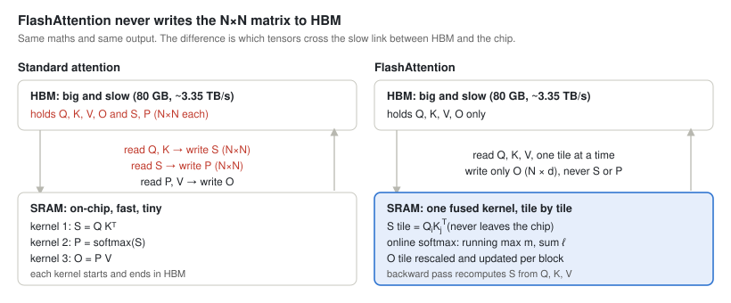
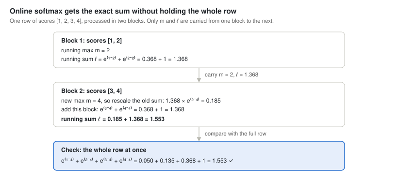
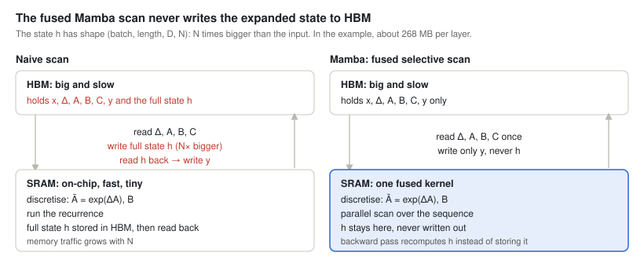

# Foundational Architecture and Representation Learning: From understanding to judgment

Oct 18, 2026 

As I wrap up this section, I wanted a final summary page that answers one question: ok, we learned all the math behind these papers, so what? How does knowing the math help me as a machine learning engineer? What do I carry with me after this exercise, and what vision or perspective should it give me?

If I just move on without reflecting, I'm no more than a parrot. That's where understanding vs judgment comes in. Implementations are all over the internet, you can find thousands of them, but this reflection feels like the missing piece. At least that's what I think.

Understanding means you can explain and rebuild a mechanism. Judgment means you can pick a mechanism under constraints and predict the consequence before you see it.

Anyone who has read these papers, or implemented them, must have noticed a lot of repetition. That got me thinking: maybe the point of this exercise isn't just going through the math. Maybe it's spotting the recurring ideas behind it. The more models I went through, the more they seemed to rely on a handful of ideas and grow from there.

This is good news, because it means I can look at any new model, idea or paper, quickly get a grasp of what it is, and predict how it will behave, how much it will cost and where it will break. Congratulations! That's basically what separates you from a parrot!

Ok, let's dig into the technical part. This is what I've seen so far, and every section ends with a question you can ask about any new model.

## 1. Where to put LayerNorm

LayerNorm takes a token's hidden vector, rescales it to mean 0 and variance 1, then applies a learned scale and bias. The point is to keep activations at a predictable scale while they pass through dozens of layers. RMSNorm (LLaMA and most LLMs now) does the same thing without subtracting the mean, so it's a bit cheaper.

**Why you need it?** A deep net is a long chain of layers. If each layer scales its output by just 1.1×, after 48 layers that's 1.1⁴⁸ ≈ 97×. At 0.9× per layer you get 0.9⁴⁸ ≈ 0.006. Gradients go back through the same chain, so they explode or vanish the same way, and training diverges or stalls.

The other piece is the **skip connection** (also called a residual connection), from ResNet. A Transformer block doesn't overwrite its input, it adds to it: x = x + F(x), where F is attention or the FFN. The input skips over the block and gets added back to its output. That running x, which every block adds to, is called the **residual stream**. Stack three blocks and you get x₃ = x₀ + F₁ + F₂ + F₃: the original input is still in the output, untouched, with each block's work added on top. It matters for training because the gradient flows back along the same routes. Through the skip connections, it isn't multiplied by anything, so it reaches layer 1 at full strength, however deep the model is. Without skip connections, the gradient gets multiplied by every layer's derivative on the way down. With 48 layers at 0.5 each, that's 0.5⁴⁸ ≈ 0, and the early layers stop learning.

So the design question is: where in the block does the norm go? Papers have tried three answers.

### Post-LN: normalise after the add (Transformer 2017, BERT)

```python
x = norm(x + attn(x))
x = norm(x + ffn(x))
```

Here the LayerNorm comes after the add, so the x that each skip connection passes to the next layer has already been rescaled by a LayerNorm. The skip itself has no weights; it's the value it carries that keeps getting normalised. The original x gets rescaled again and again, so it never reaches the output untouched. [Xiong et al. (2020)](https://arxiv.org/abs/2002.04745) showed that at initialisation the gradients for parameters near the output are large. In practice, that means you need learning-rate warmup (start with a tiny LR and ramp it up over a few thousand steps). Without it, training often diverges, and it gets worse the deeper the model is.

**Key takeaway:** This means Post-LN is harder to train. It works fine for shallow models (6 to 24 layers, like the original Transformer and BERT) as long as you use LR warmup, and when it does train, it can end up slightly better than Pre-LN. Use it when you're reproducing or fine-tuning a BERT-era model (keep the architecture its checkpoint was trained with). Avoid it for deep models or high learning rates unless you add a fix like DeepNorm.

### Pre-LN: normalise the input of each block (GPT-2 onwards)

```python
x = x + attn(norm(x))
x = x + ffn(norm(x))
x = norm(x)  # final norm before the output head
```

GPT-2 moved the norm inside the branch. Each block reads a normalised copy of x, but whatever it returns is added to the raw stream. Now the skip connections carry x untouched from the first layer to the last, gradients are well-behaved at init, and deep models train without the warmup dance. GPT-3, LLaMA and most LLMs since use this, usually with RMSNorm. GPT-2 also added a final norm before the output head, because nothing else normalises the stream.

The catch is that nothing ever rescales the stream. Every block adds to it, so its norm keeps growing with depth. That has two effects:

- **Deep layers do less.** By layer 40 a block's output is small compared with the stream, so it barely changes it. [The Curse of Depth (2025)](https://arxiv.org/abs/2502.05795) blames Pre-LN for many deep layers in LLMs being less useful than expected.
- **Huge activations stick around.** If one block outputs a very large value, it stays in the stream. In big runs this can show up as loss spikes.

**Key takeaway:** Pre-LN is the safe default when you train a Transformer today, especially a deep one. It's stable from step 1, needs little or no warmup and tolerates larger learning rates. Pair it with RMSNorm. The cost only shows up at scale, so in long or large runs watch the per-layer activation norms and look out for loss spikes.

### Peri-LN: normalise both sides (Gemma 2/3, OLMo 2)

```python
x = x + norm_out(attn(norm_in(x)))
x = x + norm_out(ffn(norm_in(x)))
```

Keep Pre-LN's input norm, and also normalise each block's output before adding it. The skip connections still carry x untouched, and no single block can dump a huge value into it. Gemma 2 and 3 do exactly this. OLMo 2 keeps only the output norm (x + norm(F(x))) and adds QK-norm, specifically for training stability.

**Key takeaway:** reach for Peri-LN when Pre-LN gets unstable at scale: loss spikes, huge activations, very deep models or very long runs. The extra norm per sublayer is cheap, which is why recent open models like Gemma 2/3 and OLMo 2 use it by default. For a small model, Pre-LN is usually enough.

The same three as equations, with F = attention or FFN:

$$\text{Post-LN:}\quad x_{l+1} = \mathrm{LN}\big(x_l + F(x_l)\big)$$

$$\text{Pre-LN:}\quad x_{l+1} = x_l + F\big(\mathrm{LN}(x_l)\big)$$

$$\text{Peri-LN:}\quad x_{l+1} = x_l + \mathrm{LN}\Big(F\big(\mathrm{LN}(x_l)\big)\Big)$$

The thing to look for: does the plain $x_l$ (x at layer $l$) sit outside every LN? In Pre-LN and Peri-LN it does, and that's the clean gradient path. In Post-LN it's wrapped inside the LN.

|  | Post-LN | Pre-LN | Peri-LN |
| --- | --- | --- | --- |
| Used by | Transformer 2017, BERT | GPT-2, GPT-3, LLaMA | Gemma 2/3, OLMo 2 (output norm only) |
| Good | Stream stays at a fixed scale | Stable at depth, little or no warmup needed | Clean skip connections, and no block output can get too big |
| Watch out for | Needs warmup; unstable when deep | Stream norm grows; deep layers underused; loss spikes | One extra norm per sublayer |

**Recommendation:** Pre-LN with RMSNorm as the default. If a large run shows loss spikes, try the output norm (Peri-LN) and QK-norm before touching the LR schedule. Post-LN only if I'm reproducing a BERT-era model.

**The question to ask about any new architecture.** These two questions predict how a model will train before you run anything:

1. **Does x pass through untouched somewhere?** If a norm sits on the skip connection (like Post-LN), expect it to need warmup and to get fragile as it gets deeper.
2. **What stops the residual stream from growing?** If nothing does (like Pre-LN), expect deep layers to do less and loss spikes at scale.

**How to catch it in your own training.** Log the activation norm and gradient norm per layer. Each failure shows up there before the loss curve looks bad:

| Problem | What you'll see in the per-layer logs |
| --- | --- |
| Post-LN blowing up | Very large gradient norms in the top layers in the first few hundred steps |
| Pre-LN stream growing | Activation norm climbing steadily with layer number |
| Loss spike coming | One layer's activation norm suddenly jumping |

```python
# gradient norm per parameter, after loss.backward()
for name, p in model.named_parameters():
    if p.grad is not None:
        log(f"grad_norm/{name}", p.grad.norm().item())

# activation norm per block, with a forward hook
for i, block in enumerate(model.blocks):
    block.register_forward_hook(
        lambda m, inp, out, i=i: log(f"act_norm/block_{i}", out.norm(dim=-1).mean().item())
    )
```

## 2. HBM vs SRAM: when memory bandwidth is the bottleneck

A GPU has two memories that matter here. HBM is the big off-chip memory (80 GB on an H100) where the weights, activations and KV cache live. SRAM is the small on-chip memory right next to the compute units (shared memory and registers: a few hundred KB per SM, tens of MB across the chip). Anything a kernel computes on has to be read from HBM into SRAM first, and the result written back.

The numbers on an H100: about 989 TFLOP/s of dense BF16 compute, but only about 3.35 TB/s of HBM bandwidth. Divide one by the other and you get roughly 295. In the time it takes to read one byte from HBM, the GPU could have done about 295 FLOPs.

That gives a simple test for any op, called arithmetic intensity:

$$\text{arithmetic intensity} = \frac{\text{FLOPs}}{\text{bytes read and written to HBM}}$$

$$\text{H100 ridge point} \approx \frac{989\ \text{TFLOP/s}}{3.35\ \text{TB/s}} \approx 295\ \text{FLOPs/byte}$$

If an op does more than about 295 FLOPs per byte, it's compute-bound: the tensor cores are the bottleneck, and only fewer or cheaper FLOPs will speed it up. If it does fewer, it's memory-bound: the GPU sits idle waiting on HBM, and only moving fewer bytes helps. A GPU with more FLOPs but the same bandwidth won't make it faster.

**When to use it.** Arithmetic intensity is a diagnostic: reach for it when something is slower than expected, or before you spend time optimising. It tells you which kind of fix will actually work.

- **Low GPU utilisation (low MFU):** your ops are probably below the line, so the GPU is waiting on memory. Fuse ops, batch more, or move fewer bytes. More FLOPs won't help.
- **Speeding up inference:** decode is memory-bound, so quantising weights and batching requests help, while a GPU with more FLOPs but the same bandwidth barely does. Prefill is the opposite.
- **Picking a GPU:** for LLM serving, look at bandwidth (TB/s) first. For large-batch training, look at FLOPs.
- **Deciding if an optimisation is worth it:** if the op is memory-bound, cutting FLOPs is wasted effort. FlashAttention does the same FLOPs as normal attention and wins purely on bytes.
- **Reading papers:** GQA, MLA, KV-cache quantisation and kernel fusion are all about bytes, not FLOPs. Thinking in intensity tells you when they'll help (decode) and when they won't matter much (training).

You rarely need an exact number. A rough guess like “each weight is used once per token, so about 1 FLOP per byte, so memory-bound” is usually enough. To measure it, use a profiler such as Nsight Compute or the PyTorch profiler.

| Op | FLOPs per byte (rough) | Bound by | What helps |
| --- | --- | --- | --- |
| Training matmul: 4096 × 4096 weights times 4096 tokens, BF16 | \~1,365 | Compute | FP8, keep the batch large |
| Decoding at batch size 1 | \~1 (each 2-byte weight does one multiply-add) | Memory | Batching, weight quantisation, smaller KV cache (GQA/MLA), speculative decoding |
| Elementwise ops: softmax, LayerNorm, GELU, residual add | < 5 | Memory | Kernel fusion (torch.compile or fused kernels) so each tensor is read once |
| Naive attention at N = 8K | Writes the N × N score matrix to HBM and reads it back | Memory | FlashAttention (F.scaled\_dot\_product\_attention): tile Q, K, V into SRAM and never write N × N |

**Worked example: decoding Llama-2-7B at batch 1.** The weights are 6.74B × 2 bytes ≈ 13.5 GB. Each new token is one forward pass that reads every weight once, so at 3.35 TB/s the ceiling is about 250 tokens/s, and you'll measure less than that. The compute barely matters: about 13.5 GFLOPs per token is nothing for a 989 TFLOP/s chip. That one calculation explains the standard serving tricks:

- **int4 weights:** 4× fewer bytes, so up to about 4× faster decode.
- **Batching 32 requests:** read the weights once, produce 32 tokens, so close to 32× the throughput until KV-cache reads or compute take over. This is what continuous batching in servers like vLLM is exploiting.
- **FlashAttention:** attention intermediates stay in SRAM instead of round-tripping through HBM.

It also explains why prefill and decode feel so different. Prefill pushes the whole prompt through in parallel, so it's a big matmul and compute-bound; that's your time to first token. Decode generates one token at a time and is memory-bound; that's your tokens per second.

### How FlashAttention and Mamba are built around this

Both use the same trick: the big intermediate tensor never leaves SRAM. Load the small inputs, do all the work on-chip in one fused kernel, and write only the small output back to HBM.

**FlashAttention.** Standard attention runs as separate kernels, and every step round-trips through HBM:

```python
S = Q @ K.T        # N×N scores, written to HBM
P = softmax(S)     # read S back, write N×N P to HBM
O = P @ V          # read P back again
```

At N = 8,192 that's 67M scores per head (about 134 MB in FP16), written and read several times, for every head in every layer. Moving that data is the cost, not the matmuls.

FlashAttention fuses all of it into one kernel and works in tiles:

1. Split Q, K and V into blocks small enough to fit in SRAM. The block size comes from the SRAM size M and the head dim d (B\_c = ⌈M / 4d⌉).
2. Load a block of K and V, and a block of Q, into SRAM, and compute that block of scores there.
3. Update the softmax incrementally (online softmax): keep a running max m and running sum ℓ for each row, and rescale the partial output whenever the max changes.
4. Accumulate the output O on-chip and write only O (N × d) to HBM. The N × N matrix never exists in HBM.
5. In the backward pass, don't store P. Recompute the score blocks from Q, K, V and the saved m and ℓ. That's more FLOPs but far fewer bytes, so it's faster overall.



*Standard attention vs FlashAttention · HBM traffic*

Left: three separate kernels, and the N × N matrices S and P make round trips to HBM. Right: one fused kernel; S only ever exists as small tiles in SRAM, and only O is written back.

Online softmax on a small example: one row of scores \[1, 2, 3, 4\], processed as two blocks.

- Block 1 is \[1, 2\]: running max m = 2, running sum $\ell = e^{1-2} + e^{2-2} = e^{-1} + e^{0} = 1.368$.
- Block 2 is \[3, 4\]: the new max is 4, so rescale the old sum by $e^{2-4}$ and add the new terms: $\ell = e^{-2} \times 1.368 + (e^{-1} + e^{0}) = 1.553$.
- Check against the full row: $e^{-3} + e^{-2} + e^{-1} + e^{0} = 1.553$. Same answer, without ever holding the whole row.



*Online softmax · two blocks, one exact result*

Only two numbers per row (m and ℓ) travel between blocks, and the final sum is exactly the same as computing the whole row at once.

The output is exactly the same as standard attention (it's not an approximation). Memory grows linearly with N instead of quadratically, and the paper reports up to 7.6× faster attention on GPT-2. HBM accesses drop from Θ(Nd + N²) to Θ(N²d² / M), which is many times fewer for typical head dims (64–128) and SRAM sizes.

**Mamba.** Mamba's selective SSM keeps a hidden state of size N for every channel, so the expanded state has shape (batch, length, D, N): N times bigger than the input. Because Δ, B and C depend on the input, Mamba can't use S4's convolution shortcut. It has to run the recurrence as a scan. A naive implementation writes that whole expanded state to HBM: at length 2,048, 4,096 channels and N = 16, that's about 134M numbers (around 268 MB) per layer.

Mamba's fused kernel avoids that:

1. Load Δ, A, B and C (about batch × length × (D + N) numbers) from HBM into SRAM.
2. Discretise (Ā = exp(ΔA), plus B̄) and run the recurrence in SRAM, using a parallel scan so it doesn't go one step at a time.
3. Write only the output y (batch × length × D) back to HBM.
4. In the backward pass, recompute the states instead of storing them.



*Naive scan vs Mamba fused scan · HBM traffic*

Same pattern as FlashAttention: the naive version spills the N-times-bigger state to HBM and reads it back; the fused kernel keeps it on-chip and writes only y.

That cuts memory traffic by about a factor of N (16× at N = 16).

Both are the “store vs recompute” and fusion motifs from section 5. For any new layer, the question is: what's the biggest intermediate tensor, and does it ever have to touch HBM?

### If I want to make something faster the same way

FlashAttention and Mamba followed the same recipe. Here it is as steps, with what each paper did at each step.

| Step | What to do | FlashAttention | Mamba |
| --- | --- | --- | --- |
| 1. Find the slow op | Profile it and check its arithmetic intensity. If it's far below the GPU's line, bytes are the problem. | Attention at long N is memory-bound | The selective scan is memory-bound |
| 2. Find the big intermediate | Which tensor is much bigger than the inputs and outputs, and how often does it cross HBM? | The N × N matrices S and P | The (batch, length, D, N) expanded state |
| 3. Find a way to compute it in pieces | This is the hard, “math” part: rewrite the computation so partial results can be combined exactly. | Online softmax: a running max and sum let blocks be combined | The recurrence is an associative scan, so it can run in parallel chunks |
| 4. Fuse and tile | One kernel; pieces sized to fit in SRAM; only the final output goes back to HBM. | Q, K, V tiles; block size set by SRAM size and head dim | Load Δ, A, B, C into SRAM, write only y |
| 5. Recompute in the backward pass | Don't store the big intermediate; keep a few small statistics and rebuild it when needed. | Keep m and ℓ per row, recompute S and P | Recompute the states |
| 6. Check and measure | Outputs must match a simple reference implementation. Then plot speed and memory against sequence length. | Exact attention, memory linear in N | Same output as the naive scan, \~N× less traffic |

Step 3 is where the real idea is. Fusing and tiling is engineering; finding a way to split the maths so the pieces combine exactly is what made both papers possible. Softmax doesn't look splittable until you see the running-max trick.

In practice, try the cheap options first. torch.compile already fuses simple elementwise chains. For attention variants, PyTorch's built-in scaled\_dot\_product\_attention and FlexAttention (custom masks and score changes, compiled to a fused kernel) cover most cases. If you do need your own kernel, Triton lets you write tiled, fused GPU kernels in Python, and that's where most people start before going to CUDA.

**When it matters day to day:** you'll rarely write a CUDA kernel, but you'll keep making decisions this explains: batch size, whether to quantise, which attention backend is running, and why GPU utilisation (MFU) looks low.

**The question to ask:** how many FLOPs does this op do per byte it moves, and is that above or below the ridge point of my GPU?

## 3. Bidirectional vs causal: encoder or decoder?

The attention math is identical in BERT and GPT. What differs is the attention mask, meaning which positions each token is allowed to attend to, plus the training objective that goes with it.

```python
T = 6  # tokens in the sequence
bidirectional = torch.ones(T, T).bool()        # encoder (BERT): every token sees every token
causal = torch.tril(torch.ones(T, T)).bool()   # decoder (GPT): token i sees tokens 0..i only
```

The causal mask exists because a decoder generates text left to right. At training time it must not see the token it's predicting, and at inference time the future tokens don't exist yet. An encoder never generates, so it has no reason to hide anything.

What that costs you: take “I sat on the bank of the river”. In a causal model, the hidden state for “bank” is built before “river” is visible, so that representation can't tell a riverbank from a money bank. In an encoder, “bank” attends to “river” directly. A decoder can still classify a whole sentence by reading the last token's hidden state, since that one has seen everything. But every earlier position only ever saw its left context.

The practical rule: if the output is a label or an embedding, the full input already exists, so use bidirectional attention. If the output is generated text, you need causal.

| Use case | Output | Good default | Why |
| --- | --- | --- | --- |
| Classification, sentiment, NER | Label per text or per token | Fine-tuned encoder (ModernBERT, DeBERTa; 100–400M params) | Full context at every token; cheap at millions of items |
| Retrieval for RAG | One embedding per text | Bi-encoder (Sentence-BERT, E5-style) | Documents are embedded once, offline |
| Reranking top-k results | Relevance score per (query, doc) pair | Cross-encoder: query and doc in one encoder pass | Query tokens and doc tokens attend to each other |
| Speech-to-text, translation | Text from a different input | Encoder-decoder (Whisper, T5) | Encode the input bidirectionally once, then decode causally |
| Chat, code completion | Generated text | Decoder-only (GPT, LLaMA, Qwen) | Generation is native, and one model covers many tasks |

**Recommendation:** for classification or retrieval at volume, start with a fine-tuned encoder. Go to an LLM when the task needs reasoning or generation, or when there's no labelled data and zero-shot is the only option. A lot of the strongest embedding models now are adapted from decoder LLMs. They're more accurate, but tens of times more expensive per item, so measure whether you actually need the gain.

**The question to ask:** when the model computes token i, which positions can it attend to, and does my task need the ones it can't see?

## 4. What the Transformer's limits look like in production

Most of the “weird” LLM behaviour you hit in production traces back to one design choice. If you know the choice, you can predict the failure before a user files a bug.

| Symptom | Root cause | Mitigation |
| --- | --- | --- |
| Long prompts are slow and expensive; OOM at long context | Prefill attention is O(n²) in sequence length, and the KV cache (the stored K and V vectors for every past token) grows linearly and is read on every decode step | Retrieve less but better (RAG), prefix caching, models with a smaller KV cache (GQA, MLA, hybrids) |
| Facts in the middle of a long prompt get missed | Models attend most reliably to the start and end of the context ([Lost in the Middle](https://arxiv.org/abs/2307.03172)) | Put key info at the start or end; don't stuff whole documents |
| Confident hallucinations | The next-token loss rewards a likely continuation, not a correct one | Ground answers in retrieved sources, add verification, run evals on your own data |
| Can't count letters; shaky arithmetic on long numbers | Subword tokenisation (BPE): the model sees chunks like “straw” + “berry”, not characters or digits | Tool use: let it run code or call a calculator |
| Fails hard problems when it answers directly | Same compute (one forward pass) per output token, regardless of difficulty | More tokens of reasoning (chain of thought, reasoning models), paid for in latency |
| Knows “A is B” but not “B is A” | Causal training only ever predicts left to right ([Reversal Curse](https://arxiv.org/abs/2309.12288)) | When fine-tuning, include facts in both directions |
| Latency floor per output token | Decoding is sequential and memory-bound (section 2) | Batching, quantisation, speculative decoding |
| Poor results when trained from scratch on small data | Weak inductive bias: almost no built-in assumptions about the data | Fine-tune a pretrained model; for small tabular data, try gradient-boosted trees or TabPFN first |

**The question to ask:** which of these will my product hit first, and is the fix in the model choice, the data, or the system around the model?

## 5. The five ideas under the nine papers

This is the repetition I kept seeing, boiled down: nine papers, five ideas. Each idea is a problem every model has to solve, and each paper is one answer to it. A new paper is usually a new answer to one of these five problems, so I can read it as a diff against something I already know.

### Idea 1: Keep the signal alive through depth

**The problem.** A deep network passes data through dozens of layers, so small per-layer changes in scale compound: 1.1⁴⁸ ≈ 97, and 0.9⁴⁸ ≈ 0.006. Activations explode or gradients vanish, and training fails.

**How the papers handle it:**

- **ResNet:** skip connections (x + F(x)), so the gradient always has a direct route back to the early layers.
- **Transformer:** divides attention scores by √d\_k. A dot product of two d\_k-dimensional vectors has variance around d\_k, so without the scaling softmax saturates to nearly one-hot and its gradients become tiny.
- **GPT-2:** Pre-LN, plus scaling each residual block's output weights at init by 1/√N, because each of the N blocks adds variance to the residual stream.
- **Mamba:** the state's decay factor is exp(ΔA) with A negative, so it always stays between 0 and 1 and the recurrence can't blow up.

**In practice:** when a run diverges or stalls, check scale first: per-layer activation and gradient norms (section 1).

*Ask: what keeps activations and gradients at a sane scale as the model gets deeper?*

### Idea 2: The objective shapes the model as much as the architecture

**The problem.** The architecture decides what a model *can* represent. The loss decides what it actually learns to do.

**How the papers show it:**

- **BERT:** predicts masked words using context on both sides. That gives great representations for understanding tasks, but only about 15% of tokens produce a training signal, and it isn't a natural text generator.
- **GPT-2:** predicts the next word. Every token produces a signal, generation comes for free, and zero-shot task behaviour emerges from diverse data. BERT and GPT-2 use almost the same block; the objective is what makes them different.
- **ResNet and ViT:** trained on labelled images, so they learn features that are useful for the labels they were given.

**In practice:** hallucination is exactly what next-token loss predicts. It rewards a plausible continuation, not a true one. It's also why a base model doesn't follow instructions until it's been instruction-tuned.

*Ask: what exactly does the loss reward, and what behaviour will follow from that?*

### Idea 3: Built-in assumptions vs data (inductive bias)

**The problem.** Every architecture assumes something about its data. When the assumption is right, it saves you data. When you have lots of data, it becomes a ceiling.

**How the papers show it:**

- **ResNet (CNNs):** assumes nearby pixels belong together (locality) and the same pattern can appear anywhere (weight sharing). Very data-efficient.
- **ViT:** assumes almost nothing beyond cutting the image into patches. It does worse than ResNet when trained on ImageNet-1k alone, and only overtakes it after pretraining on JFT-300M.
- **Transformer:** has no sense of word order without a positional encoding, so choosing sinusoidal, learned or RoPE positions is choosing an assumption.
- **Mamba:** assumes the history can be compressed into a fixed-size state, with recent information easier to keep.
- **MoE:** assumes inputs fall into groups that different experts can specialise in.

**In practice:** with little data, buy assumptions (a pretrained model, a CNN, data augmentation). With lots of data, drop them. And when a paper claims an architecture win, check the training recipes were equal: ConvNeXt showed a ResNet with a modern recipe and design tweaks can match Swin.

*Ask: what does this model assume, and do I have enough data to not need it?*

### Idea 4: How a model remembers context

**The problem.** To predict the next token, a model needs the past. The real questions are how much of it to keep and what it costs to look it up.

**How the papers handle it:**

- **Attention:** keeps K and V for every past token (the KV cache). Lookup is exact, but prefill costs O(n²), the cache grows with every token, and every decoding step reads all of it.
- **Mamba:** compresses the whole history into a fixed-size state. Each step costs the same however long the input is, but some detail is lost, so it's weaker at exact copying and recall. Its real contribution is that what gets written into the state depends on the input, so it chooses what to keep.
- **FlashAttention:** doesn't change what attention remembers, only how efficiently it's computed.
- **Hybrids (Jamba):** mostly Mamba layers, plus a few attention layers for exact recall.

**In practice:** tasks that need exact retrieval (code, RAG, long documents) favour attention. Very long or streaming inputs, where losing some detail is acceptable, favour SSMs or hybrids.

*Ask: how much state does it keep per token of history, and what does reading it cost?*

### Idea 5: Compute is the real currency

**The problem.** Capability is bought with FLOPs and bytes. Since about 2020, most architecture papers are answering one question: how do I get more capability per FLOP, or per byte?

**How the papers handle it:**

- **Scaling laws:** loss falls as a predictable power law in parameters, data and compute. Chinchilla later put the compute-optimal ratio at about 20 training tokens per parameter.
- **FlashAttention:** FLOPs aren't wall-clock time. Bytes moved between HBM and SRAM are (section 2).
- **MoE:** separates total parameters from the ones used per token. Mixtral has 46.7B parameters but uses about 12.9B per token.
- **Mamba:** a hardware-aware scan that keeps its state in fast on-chip memory.

**In practice:** for any operation, ask whether it's limited by compute or by memory bandwidth, because that tells you which optimisation will help. Use the estimates in section 6 to cost a design before you build it.

*Ask: is this limited by compute or by memory bandwidth?*

Inside those ideas, the same five motifs keep coming back:

- **Skip connection:** ResNet, the LSTM cell state, Pre-LN, the residual stream.
- **Gating:** LSTM gates, SwiGLU, Mamba's gate branch, the MoE router.
- **Store vs recompute:** gradient checkpointing, FlashAttention's backward pass, Mamba's scan.
- **Conditional computation:** MoE, sparse attention, Mamba's input-dependent selection.
- **Normalising scale:** BatchNorm, LayerNorm, RMSNorm, QK-norm.

## 6. Back-of-the-envelope numbers

Before anyone writes code, someone asks “will it fit, and what will it cost?” These six estimates cover most of those conversations.

**1. Training compute.** For N parameters trained on D tokens (forward pass ≈ 2ND FLOPs, backward ≈ 4ND):

$$C \approx 6\,N\,D$$

Sanity check on a real run. Llama-2-7B: 6 × 6.74B × 2T ≈ 8.1 × 10²² FLOPs. Meta reported 184,320 A100-hours. Divide and you get about 122 TFLOP/s per GPU, which is 39% of the A100's 312 TFLOP/s BF16 peak. That's a normal MFU, so the formula holds. If your estimate is off by 10×, you've missed a term.

**2. Training memory.** With Adam in mixed precision, budget about 16 bytes per parameter before activations: BF16 weights and gradients, plus FP32 master weights and two Adam moments. A 7B model needs about 112 GB, so it won't train on one 80 GB GPU without sharding (FSDP or ZeRO).

**3. KV cache per token.** Each layer stores one K and one V vector per KV head:

$$\text{KV bytes per token} = 2 \times n_{\text{layers}} \times n_{\text{kv heads}} \times d_{\text{head}} \times \text{bytes per value}$$

Llama-2-7B in FP16: 2 × 32 × 32 × 128 × 2 = 0.5 MiB per token, so a single 4K-token sequence holds 2 GiB of KV cache. With GQA and 8 KV heads instead of 32, it's 4× smaller.

**4. Decode speed ceiling.** From section 2, decode is memory-bound, so for a single sequence:

$$\text{tokens/s} \lesssim \frac{\text{HBM bandwidth}}{\text{weight bytes} + \text{KV-cache bytes}}$$

**5. MoE: memory vs compute.** Every expert has to be resident in memory, but each token only runs through a few. Mixtral 8×7B has 46.7B total parameters (about 93 GB in BF16, so two 80 GB GPUs) but only 12.9B active per token. It's cheap per token only when the batch is big enough to keep all experts busy; at small batch you pay the memory without the savings.

**6. Tokens per parameter.** Chinchilla puts the compute-optimal point at roughly 20 training tokens per parameter. Models meant for heavy serving train far past that on purpose, because a smaller model trained longer is cheaper on every inference call.

## Sources

- [On Layer Normalization in the Transformer Architecture](https://arxiv.org/abs/2002.04745) (Xiong et al., 2020): Post-LN gradients near the output and warmup.
- [Understanding the Difficulty of Training Transformers](https://arxiv.org/abs/2004.08249) (Liu et al., 2020): Post-LN vs Pre-LN quality.
- [Peri-LN: Revisiting Normalization Layer in the Transformer Architecture](https://arxiv.org/abs/2502.02732) (2025): the double-norm block, Gemma 2/3 and OLMo 2.
- [The Curse of Depth in Large Language Models](https://arxiv.org/abs/2502.05795) (2025): Pre-LN variance growth and underused deep layers.
- [2 OLMo 2 Furious](https://arxiv.org/abs/2501.00656) (2025): output-side RMSNorm and QK-norm.
- [NVIDIA H100 specifications](https://glennklockwood.com/garden/processors/H100): 989 TFLOP/s dense BF16, 3.35 TB/s.
- [FlashAttention](https://arxiv.org/abs/2205.14135) (Dao et al., 2022): IO-aware attention.
- [Llama 2](https://arxiv.org/abs/2307.09288) (Touvron et al., 2023): 7B shape and 184,320 A100-hours.
- [Lost in the Middle](https://arxiv.org/abs/2307.03172) (Liu et al., 2023) and [The Reversal Curse](https://arxiv.org/abs/2309.12288) (Berglund et al., 2023).
- [Training Compute-Optimal Large Language Models](https://arxiv.org/abs/2203.15556) (Hoffmann et al., 2022) and [Mixtral of Experts](https://arxiv.org/abs/2401.04088) (Jiang et al., 2024).
